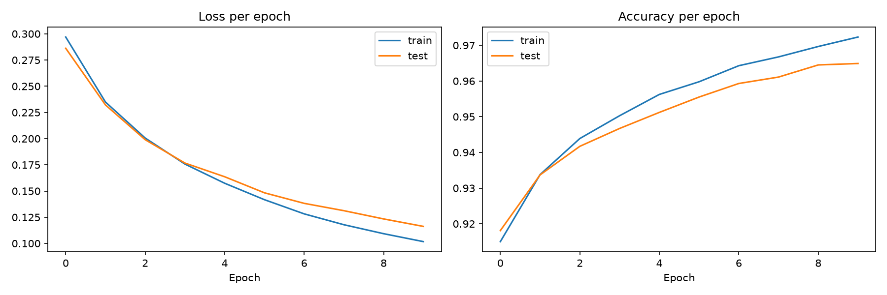

# neural-net-from-zero

A neural network that reads handwritten digits, built from scratch with NumPy. No PyTorch or TensorFlow.

## Result

96.49% test accuracy on MNIST (10,000 images the network never saw during training). This was one hidden layer of 64 neurons, learning rate 0.1, trained for 10 epochs.

## What I built

- Loaded the 70,000 MNIST images, scaled the pixels from 0-255 down to 0-1, and split them into 60,000 for training and 10,000 for testing.
- Wrote the forward pass: the network multiplies the pixels by weights, applies ReLU, then softmax to turn the output into 10 probabilities (one per digit).
- Used cross-entropy as the loss, which measures how much probability the network gave to the correct digit.
- Wrote backpropagation by hand, so each weight gets a gradient that says which way to change it.
- Wrote the training loop: shuffle the data, take batches of 128, update the weights, repeat.
- Added a gradient check that compares my backprop against a slow numerical method. The two agreed to about 8 decimal places, so I know my backprop is correct.

## Experiments

I changed one setting at a time and recorded the test accuracy. Everything was 5 epochs unless it says otherwise, with 64 hidden neurons and learning rate 0.1 as the baseline. Full table in `experiment_results.csv`.

| Setting | Test accuracy |
|---|---|
| learning rate 0.001 | 80.25% |
| learning rate 0.01 | 90.82% |
| learning rate 0.1 (baseline) | 95.44% |
| learning rate 0.5 | 97.32% |
| learning rate 2.0 | 20.71% |
| hidden layer 4 | 84.97% |
| hidden layer 16 | 93.41% |
| hidden layer 128 | 95.77% |
| hidden layer 256 | 95.88% |
| 1 epoch | 92.00% |
| 20 epochs | 97.09% |

What I found:

- **Learning rate:** If it was too small (0.001 or 0.01), the network learned too slowly to get far in 5 epochs. If it was too big (2.0), training broke and accuracy fell to about 20%, close to random guessing. 0.5 did better than my starting value of 0.1.
- **Hidden layer size:** Bigger helped a lot at first (4 to 16 to 128), but 256 was only 0.11 points better than 128, which is about 11 images and could just be luck. It doesn't look worth the extra size.
- **Epochs:** Training for 20 epochs instead of 5 improved test accuracy, but training accuracy went up faster (98.24% vs 97.09% test). That growing gap suggests the network is starting to memorize the training images a little.

## What went wrong and what I learned

- Python wasn't installed, so the terminal said "Python was not found". I installed it and then had to restart VS Code before it showed up.
- PowerShell blocked the environment from activating ("running scripts is disabled"). I fixed it by changing the execution policy for that terminal session.
- VS Code kept saying "Detecting Kernels" and couldn't find my environment, so I registered it manually.
- I made a typo when renaming the notebook and had to fix the file name in Git.
- What surprised me most was how badly a learning rate of 2.0 broke the network, and that the gradient check made me trust my own backprop code.

## Limitations

- I picked settings by looking at the test set. A proper approach would use a separate validation set.
- Each result comes from a single run with one random seed, so small differences (like 128 vs 256 hidden neurons) may not mean anything.
- I only tried one hidden layer.

## How to run it

1. Install: `pip install numpy pandas matplotlib scikit-learn jupyter`
2. Open `mnist_from_scratch.ipynb` and run all cells. The first run downloads MNIST, so it needs an internet connection.

## Notes

I built this while learning, using an AI assistant as a tutor to explain ideas and help me debug.
